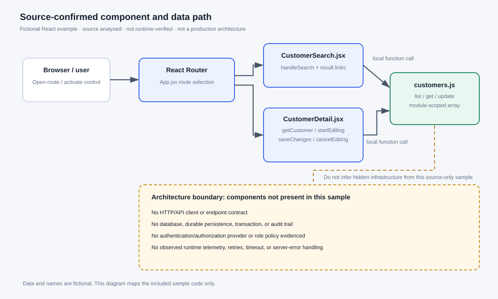
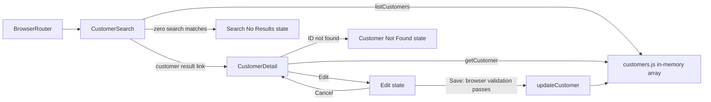

# Developer and architect trace — fictional Customer Admin

## Scope and evidence

This is a **source-only example** built from the included fictional React repository. It was not run in a browser. UI behaviour is source-confirmed when it maps directly to code; the business purpose is an analyst interpretation and must be validated by a product owner (PO) or business analyst (BA).

- **No backend is implemented.** `customers.js` holds module-scoped in-memory data. There is no HTTP request, API contract, database, durable persistence, authentication provider, authorization policy, or audit mechanism in the sample.
- **No production architecture is implied.** Missing integrations are unknown/not included, not proof that a real target system lacks them.
- **Visual evidence:** each SVG is a reconstructed schematic layout, not a browser screenshot. Runtime observation count is zero.

## Source-confirmed component and data path



| Layer | Source / symbol | What the sample does | What is not evidenced |
|---|---|---|---|
| Route entry | `src/App.jsx` · `App` | `/` redirects to `/customers`; `/customers` renders `CustomerSearch`; `/customers/:customerId` renders `CustomerDetail` | Route guards, role restrictions, server-side routing |
| Search UI | `src/pages/CustomerSearch.jsx` · `handleSearch` | Trims and lowercases the submitted query; matches name **or** email; links to selected customer IDs | Remote search, pagination, result limits, server-side filtering |
| Detail UI | `src/pages/CustomerDetail.jsx` · `startEditing`, `saveChanges`, `cancelEditing` | Renders a known customer, an in-place edit state, or a not-found state | Concurrency/version checks, role-based update policy, durable error handling |
| Mock data access | `src/services/customers.js` · `listCustomers`, `getCustomer`, `updateCustomer` | Reads copies from and updates a module-scoped array | HTTP client, API endpoint, database, transaction, audit, durable storage |

## Interaction trace



The model deliberately distinguishes **route navigation** (e.g. opening `/customers/:customerId`) from **in-place state changes** (e.g. entering edit mode). `SCR-005` is the no-results state on `/customers`; it is not a new route. `SCR-003` is the not-found state on the detail route.

The interaction model adds an optional `screenIds` list when the same action appears in multiple starting states. For compatibility, `screenId` remains the primary/legacy field. Example: `ACT-006` (Back to search) appears in both `SCR-002` and `SCR-003`; `ACT-001` (Search) remains available in `SCR-001` and `SCR-005`.

## PO / BA review prompts

These are **questions to resolve**, not requirements discovered in the code.

| Topic | Evidence in sample | Confirm with PO / BA |
|---|---|---|
| Search semantics | Partial, case-insensitive match against name or email; blank query returns all in-memory records | Is partial match intended? Should blank search list everything? Are there result limits or pagination requirements? |
| No results | A status message appears; the form remains usable | Is this wording adequate? Should it include a clear/reset action or search suggestions? |
| Customer detail | Name and email are displayed | Are these fields appropriate for the user’s role? Are there field-masking rules? |
| Edit validation | Name/email are required; browser checks email format | What are the authoritative format, uniqueness, and business validations? Which rules must be enforced server-side? |
| Save outcome | In-memory update shows a status message | What constitutes a successful save? What error should be shown for authorization, conflict, timeout, or server failure? |
| Access control | No access-control code is present in the sample | Which roles may view or update customers? Where must authorization be enforced? |
| Audit and privacy | No audit or data classification is included | Should changes be audited? Are there retention, privacy, masking, or consent requirements? |

## Developer checks / acceptance scenarios

1. Submit a matching name; verify the matching result is rendered and the link contains that record ID.
2. Submit a matching email with different letter case; verify case-insensitive match behaviour.
3. Submit a query with zero matches; verify `SCR-005` is shown and the input/Search control remain available.
4. From `SCR-005`, search again with a matching query; verify a return to the matching/results state.
5. Open a known ID directly; verify `SCR-002`. Open an unknown ID; verify `SCR-003` on the same route pattern.
6. Select Edit; verify it is an in-place state change and no URL change is implied by the sample.
7. Try empty name or invalid email; verify browser-native validation blocks submission.
8. Save valid values; verify the displayed value changes in memory and the success status appears. Refresh the page and note that persistence is not implemented.
9. Cancel a draft; verify the current values remain unchanged.
10. Verify `ACT-006` appears in both detail and not-found states and returns to `/customers`.

These are recommended test cases derived from source behaviour, not execution results.

## Architect review — explicitly unknown or absent

The current sample only supports this topology:

```text
Browser / React Router
  ├── CustomerSearch.jsx ─┐
  └── CustomerDetail.jsx ─┼── customers.js ── module-scoped in-memory array
                         └── no remote API boundary in this example
```

Before treating this as an architecture for a real application, discover and verify:

- API ownership, endpoint contract, schemas, timeouts, retries, and error mapping.
- Authentication, authorization, session/token handling, and route/data access controls.
- Data persistence, transaction/concurrency strategy, and update conflict handling.
- Auditability, sensitive-field exposure, data retention, and privacy controls.
- Observability: correlation IDs, structured logs, metrics, traces, and alerting.
- Deployment/runtime boundaries, environment configuration, service dependencies, and resilience behaviour.

Do not fill these gaps with guesses. Record them as **not found / not evidenced** and inspect the target repository, API specifications, deployment config, infrastructure manifests, and runtime behaviour if available.

## Evidence accounting

- Source files are under `../sample-repository/src/`.
- Canonical inventories: `screens/screens.json` and `screens/interaction-model.json`.
- Evidence status is `source-confirmed` for behaviour supported by code. Nothing is `runtime-observed`.
- Business-intent text in the HTML portal is labelled as inferred so it is not confused with an approved business requirement.
